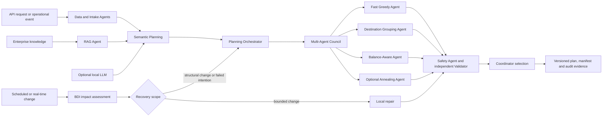

# UOW CSIT321 Backend Multi-Agent Design

This private teaching repository contains the backend multi-agent subsystem of an agentic steel batching and wagon-loading platform. It is intended to help CSIT321 students understand, test, and extend a realistic multi-agent application without exposing the production web interface, customer data, or research-result packages.

## 1. Project purpose

Steel products vary in weight, dimensions, destination, and operational priority. Wagons have payload, geometry, placement, and balance constraints. A feasible plan must satisfy every hard constraint, while a useful plan should also reduce wagon usage, improve utilisation and balance, support practical unloading, and respond safely when orders or resources change.

The backend separates these responsibilities instead of asking one model or algorithm to make every decision:

- **LLM components understand ambiguous language and provide advisory semantics.**
- **RAG retrieves enterprise rules and relevant historical cases.**
- **Optimisation agents calculate candidate loading plans.**
- **The Multi-Agent Council compares distinct planning strategies.**
- **BDI and reconsideration logic adapt plans when operational facts change.**
- **Safety checks and the independent Validator control release.**
- **Audit and manifest services preserve evidence and traceability.**

The LLM is not a safety authority. It cannot approve a loading plan, invent missing critical loading facts, or override deterministic validation.

## 2. Repository scope

Included:

- multi-agent domain and orchestration code;
- REST API and background worker entry points;
- deterministic optimisation, validation, BDI, and replanning logic;
- optional local LLM and RAG adapters;
- SQLite-backed operational state and job processing;
- backend tests, technical documentation, and synthetic examples.

Deliberately excluded:

- the HTML/JavaScript and Streamlit frontends;
- dashboards and browser assets;
- customer spreadsheets or confidential operational data;
- generated plans, runtime databases, logs, videos, and research results.

## 3. Architecture



The API is an application boundary, not an agent. It validates requests, persists state, creates idempotent jobs, and exposes results. Long-running planning work can execute in a separately supervised worker so that HTTP requests remain responsive.

## 4. Agent definitions and boundaries

| Component | Main responsibility | Principal input | Principal output | Decision boundary |
|---|---|---|---|---|
| Data Agent and intake services | Map columns, normalise types and units, identify invalid or excluded rows, and retain source evidence | Excel/JSON product records | Canonical product records and validation evidence | Must not guess critical dimensions, weight, destination, or identity |
| Enrichment Agent | Suggest or confirm repairs for non-critical descriptions and semantic metadata | Canonical records plus user confirmation | Confirmed enrichment record | Suggestions remain explicit and auditable; critical facts are never fabricated |
| RAG Agent | Retrieve constraints and relevant historical cases | Query and knowledge base | Ranked context with provenance | Retrieval is advisory and cannot change hard constraints |
| LLM/Semantic Planner | Interpret operational intent and produce a structured strategy proposal | User intent, canonical data, retrieved context | Validated strategy-plan proposal | Output must satisfy a schema and may fall back to deterministic policy |
| Planning Orchestrator | Control the end-to-end workflow, deadlines, fallbacks, manifests, and stage transitions | Planning request and strategy plan | Candidate execution evidence and final plan | Does not bypass Validator results |
| FastGreedyAgent | Find a feasible, balanced candidate quickly | Products, constraints, time budget | Candidate loading solution | Candidate only; no release authority |
| DestinationGroupingAgent | Prioritise destination grouping and unloading clarity | Products, constraints, time budget | Candidate loading solution | Candidate only; no release authority |
| BalanceAwareAgent | Balance destination grouping, utilisation, and weight distribution | Products, constraints, time budget | Candidate loading solution | Candidate only; no release authority |
| AnnealingAgent | Explore a higher-effort candidate when the deadline permits | Products, constraints, extended budget | Candidate loading solution | Optional anytime candidate; no release authority |
| Safety Agent | Veto candidates that fail hard constraints | Candidate plan and expected products | Pass/veto evidence with reasons | Can reject; cannot make an invalid candidate valid |
| Coordinator Agent | Rank only safety-valid candidates using deterministic evidence | Evaluated candidates | Selected candidate and rationale | Cannot select a vetoed candidate |
| BDI/Reconsideration Agents | Update beliefs after events or validation failures, reconsider the current intention, and choose a recovery scope | Current plan, event, validation state | Local-repair or global-replanning intention | Recovery must return through independent validation |
| Validation Agent | Independently verify completeness, payload, geometry, overlap, boundaries, and balance-related rules | Final candidate and expected products | Versioned validation report | Final technical release gate |
| Audit/Manifest services | Record inputs, versions, hashes, stages, fallbacks, validation, and artifacts | Full run evidence | Reproducible manifest and audit report | Evidence is immutable for a completed run |

## 5. Multi-Agent Council

The Council is a coordinated set of specialised agents, not one monolithic agent. Each candidate agent receives a controlled share of the available deadline and executes a distinct planning policy. Evaluators record feasibility, utilisation, balance, destination grouping, objective value, and runtime evidence. The Safety Agent vetoes invalid candidates. The Coordinator then applies a deterministic ranking to the remaining candidates and records why the winner was selected.

With at least six seconds of total planning budget, the Council may add an `AnnealingAgent`. Under tighter deadlines it returns the best validated candidate already available. This supports an anytime design while preserving the same safety gate.

## 6. Static and dynamic workflows

### Static planning

1. The API accepts an Excel or JSON request and creates a durable intake record.
2. Data services normalise and validate the products; invalid rows are reported rather than silently discarded.
3. RAG and the optional LLM provide structured semantic advice. Deterministic policy remains available when the model is unavailable or its output is invalid.
4. The Planning Orchestrator runs the Council within the configured deadline.
5. Safety and validation gates reject invalid candidates.
6. The selected result, artifacts, hashes, version information, and audit evidence are persisted.
7. Approval or rejection is an explicit downstream action.

### Dynamic replanning

Operational events can be submitted immediately or placed into a persistent scheduling window. Event identity and plan versioning prevent accidental duplicate application. The BDI layer updates its beliefs from the event and current plan, assesses impact, and selects the smallest safe response:

- bounded additions or cancellations may use local repair;
- destination or resource changes may require broader replanning;
- a failed validation can trigger reconsideration and escalation instead of repeating the same failed intention.

Every recovered plan must pass the same independent Validator before it becomes a successor version.

## 7. Technology stack

- Python 3.11-3.13
- Starlette and Uvicorn for the REST service
- Pydantic for API contracts
- pandas/openpyxl for tabular ingestion
- SQLite for durable lightweight state, jobs, events, plan versions, and idempotency records
- LangChain-compatible RAG adapters and Chroma for local retrieval
- Ollama for an optional local LLM (`qwen2.5:0.5b` by default)
- matplotlib for backend-generated plan artifacts
- pytest, Ruff, mypy, and pip-audit for engineering quality checks

## 8. Project structure

```text
Agents/                         multi-agent domain and application services
  core/                         shared agent, task, event and research contracts
  wrappers/                     adapters around selected agents
KnowledgeBase/                  example constraints and historical cases
docs/                           API, operations and integration documentation
examples/                       synthetic request data only
tests/                          focused backend tests
backend_api.py                  Starlette REST API
worker.py                       durable background job worker
operations_cli.py               maintenance and operational commands
start_backend_api.ps1           Windows API launcher
start_backend_worker.ps1        Windows worker launcher
```

## 9. Local setup

From PowerShell:

```powershell
py -3.13 -m venv .venv
.\.venv\Scripts\python.exe -m pip install --upgrade pip
.\.venv\Scripts\python.exe -m pip install -r requirements.txt
```

The backend reads environment variables from the process; it does not silently load a `.env` file. `.env.example` is a configuration reference. Set only the values needed in the terminal or use a supervised deployment environment. Do not commit production secrets.

Start the API:

```powershell
.\start_backend_api.ps1 -Port 8080
```

The development configuration uses an embedded worker by default. To demonstrate production-style separation, start the API and worker in separate terminals with the same data root.

API terminal:

```powershell
$env:STEEL_API_EMBEDDED_WORKER = "false"
.\start_backend_api.ps1 -Port 8080 -DataRoot runtime/api
```

Worker terminal:

```powershell
.\start_backend_worker.ps1 -DataRoot runtime/api
```

Health endpoints:

- `GET http://127.0.0.1:8080/health/live`
- `GET http://127.0.0.1:8080/health/ready`
- `GET http://127.0.0.1:8080/metrics`
- `GET http://127.0.0.1:8080/openapi.json`

See [docs/BACKEND_API.md](docs/BACKEND_API.md) for the request lifecycle and endpoint details.

## 10. Optional local LLM

The default provider is Ollama with the small `qwen2.5:0.5b` model. The deterministic planning and safety path remains operational if the model is unavailable.

```powershell
ollama serve
ollama pull qwen2.5:0.5b
$env:LLM_PROVIDER = "ollama"
$env:LLM_MODEL = "qwen2.5:0.5b"
$env:LLM_BASE_URL = "http://127.0.0.1:11434"
```

An organisation can connect another local or private model through the provider abstraction described in [docs/LLM_PROVIDER_INTEGRATION.md](docs/LLM_PROVIDER_INTEGRATION.md). Model output remains advisory and schema-validated.

## 11. Tests

Run the backend suite:

```powershell
.\.venv\Scripts\python.exe -m pytest -q
```

Useful focused tests:

```powershell
.\.venv\Scripts\python.exe -m pytest tests/test_multi_agent_council.py -q
.\.venv\Scripts\python.exe -m pytest tests/test_agent_orchestration.py -q
.\.venv\Scripts\python.exe -m pytest tests/test_robust_replanning_recovery.py -q
```

## 12. Student work boundaries

Students may extend agent observability, add tested strategies, improve event prioritisation, develop new validation evidence, or consume the documented API from a separate capstone frontend. Changes should preserve these invariants:

1. critical loading facts must come from validated business input;
2. LLM/RAG output is advisory;
3. every selected or recovered plan must pass independent validation;
4. state-changing requests must remain versioned and idempotent;
5. failures must be structured, visible, and auditable;
6. no real customer data or secrets may be committed.

Use feature branches and pull requests. Add or update tests for every behavioural change, and document any API contract change.

## 13. Further documentation

- [Backend API](docs/BACKEND_API.md)
- [Multi-Agent Council v2](docs/multi_agent_council_v2.md)
- [LLM provider integration](docs/LLM_PROVIDER_INTEGRATION.md)
- [Data repair workflow](docs/DATA_REPAIR_WORKFLOW.md)
- [Operations runbook](docs/OPERATIONS_RUNBOOK.md)
- [Continuous operations handoff](docs/CONTINUOUS_OPERATIONS_HANDOFF.md)
- [Security policy](SECURITY.md)

