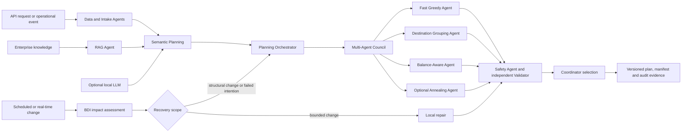

# UOW CSIT321 Backend Multi-Agent Design

This private teaching repository contains the backend multi-agent subsystem of an agentic steel batching and wagon-loading platform. It is intended to help CSIT321 students understand, test, and extend a realistic multi-agent application without exposing the production web interface, customer data, or research-result packages.

## 1. Project purpose

Steel products vary in weight, dimensions, destination, and operational priority. Wagons have payload, geometry, placement, and balance constraints. A feasible plan must satisfy every hard constraint, while a useful plan should also reduce wagon usage, improve utilisation and balance, support practical unloading, and respond safely when orders or resources change.

The backend separates these responsibilities instead of asking one model or algorithm to make every decision:

- **LLM components understand ambiguous language and provide advisory semantics.**
- **RAG retrieves enterprise rules and relevant historical cases.**
- **Optimisation agents calculate candidate loading plans.**
- **The Multi-Agent Council compares distinct planning strategies.**
- **BDI and reconsideration logic adapt plans when operational facts change.**
- **Safety checks and the independent Validator control release.**
- **Audit and manifest services preserve evidence and traceability.**

The LLM is not a safety authority. It cannot approve a loading plan, invent missing critical loading facts, or override deterministic validation.

## 2. Repository scope

Included:

- multi-agent domain and orchestration code;
- REST API and background worker entry points;
- deterministic optimisation, validation, BDI, and replanning logic;
- optional local LLM and RAG adapters;
- SQLite-backed operational state and job processing;
- backend tests, technical documentation, and synthetic examples.

Deliberately excluded:

- the HTML/JavaScript and Streamlit frontends;
- dashboards and browser assets;
- customer spreadsheets or confidential operational data;
- generated plans, runtime databases, logs, videos, and research results.

## 3. Architecture



The API is an application boundary, not an agent. It validates requests, persists state, creates idempotent jobs, and exposes results. Long-running planning work can execute in a separately supervised worker so that HTTP requests remain responsive.

## 4. Agent definitions and boundaries

| Component | Main responsibility | Principal input | Principal output | Decision boundary |
|---|---|---|---|---|
| Data Agent and intake services | Map columns, normalise types and units, identify invalid or excluded rows, and retain source evidence | Excel/JSON product records | Canonical product records and validation evidence | Must not guess critical dimensions, weight, destination, or identity |
| Enrichment Agent | Suggest or confirm repairs for non-critical descriptions and semantic metadata | Canonical records plus user confirmation | Confirmed enrichment record | Suggestions remain explicit and auditable; critical facts are never fabricated |
| RAG Agent | Retrieve constraints and relevant historical cases | Query and knowledge base | Ranked context with provenance | Retrieval is advisory and cannot change hard constraints |
| LLM/Semantic Planner | Interpret operational intent and produce a structured strategy proposal | User intent, canonical data, retrieved context | Validated strategy-plan proposal | Output must satisfy a schema and may fall back to deterministic policy |
| Planning Orchestrator | Control the end-to-end workflow, deadlines, fallbacks, manifests, and stage transitions | Planning request and strategy plan | Candidate execution evidence and final plan | Does not bypass Validator results |
| FastGreedyAgent | Find a feasible, balanced candidate quickly | Products, constraints, time budget | Candidate loading solution | Candidate only; no release authority |
| DestinationGroupingAgent | Prioritise destination grouping and unloading clarity | Products, constraints, time budget | Candidate loading solution | Candidate only; no release authority |
| BalanceAwareAgent | Balance destination grouping, utilisation, and weight distribution | Products, constraints, time budget | Candidate loading solution | Candidate only; no release authority |
| AnnealingAgent | Explore a higher-effort candidate when the deadline permits | Products, constraints, extended budget | Candidate loading solution | Optional anytime candidate; no release authority |
| Safety Agent | Veto candidates that fail hard constraints | Candidate plan and expected products | Pass/veto evidence with reasons | Can reject; cannot make an invalid candidate valid |
| Coordinator Agent | Rank only safety-valid candidates using deterministic evidence | Evaluated candidates | Selected candidate and rationale | Cannot select a vetoed candidate |
| BDI/Reconsideration Agents | Update beliefs after events or validation failures, reconsider the current intention, and choose a recovery scope | Current plan, event, validation state | Local-repair or global-replanning intention | Recovery must return through independent validation |
| Validation Agent | Independently verify completeness, payload, geometry, overlap, boundaries, and balance-related rules | Final candidate and expected products | Versioned validation report | Final technical release gate |
| Audit/Manifest services | Record inputs, versions, hashes, stages, fallbacks, validation, and artifacts | Full run evidence | Reproducible manifest and audit report | Evidence is immutable for a completed run |

## 5. Multi-Agent Council

The Council is a coordinated set of specialised agents, not one monolithic agent. Each candidate agent receives a controlled share of the available deadline and executes a distinct planning policy. Evaluators record feasibility, utilisation, balance, destination grouping, objective value, and runtime evidence. The Safety Agent vetoes invalid candidates. The Coordinator then applies a deterministic ranking to the remaining candidates and records why the winner was selected.

With at least six seconds of total planning budget, the Council may add an `AnnealingAgent`. Under tighter deadlines it returns the best validated candidate already available. This supports an anytime design while preserving the same safety gate.

## 6. Static and dynamic workflows

### Static planning

1. The API accepts an Excel or JSON request and creates a durable intake record.
2. Data services normalise and validate the products; invalid rows are reported rather than silently discarded.
3. RAG and the optional LLM provide structured semantic advice. Deterministic policy remains available when the model is unavailable or its output is invalid.
4. The Planning Orchestrator runs the Council within the configured deadline.
5. Safety and validation gates reject invalid candidates.
6. The selected result, artifacts, hashes, version information, and audit evidence are persisted.
7. Approval or rejection is an explicit downstream action.

### Dynamic replanning

Operational events can be submitted immediately or placed into a persistent scheduling window. Event identity and plan versioning prevent accidental duplicate application. The BDI layer updates its beliefs from the event and current plan, assesses impact, and selects the smallest safe response:

- bounded additions or cancellations may use local repair;
- destination or resource changes may require broader replanning;
- a failed validation can trigger reconsideration and escalation instead of repeating the same failed intention.

Every recovered plan must pass the same independent Validator before it becomes a successor version.

## 7. Technology stack

- Python 3.11-3.13
- Starlette and Uvicorn for the REST service
- Pydantic for API contracts
- pandas/openpyxl for tabular ingestion
- SQLite for durable lightweight state, jobs, events, plan versions, and idempotency records
- LangChain-compatible RAG adapters and Chroma for local retrieval
- Ollama for an optional local LLM (`qwen2.5:0.5b` by default)
- matplotlib for backend-generated plan artifacts
- pytest, Ruff, mypy, and pip-audit for engineering quality checks

## 8. Project structure

```text
Agents/                         multi-agent domain and application services
  core/                         shared agent, task, event and research contracts
  wrappers/                     adapters around selected agents
KnowledgeBase/                  example constraints and historical cases
docs/                           API, operations and integration documentation
examples/                       synthetic request data only
tests/                          focused backend tests
backend_api.py                  Starlette REST API
worker.py                       durable background job worker
operations_cli.py               maintenance and operational commands
start_backend_api.ps1           Windows API launcher
start_backend_worker.ps1        Windows worker launcher
```

## 9. Five-minute quick start

### Prerequisites

- Git
- Python 3.11, 3.12, or 3.13 (Python 3.11 is recommended for the broadest package compatibility)
- at least 2 GB of free disk space
- PowerShell on Windows, or a POSIX shell on macOS/Linux

Ollama is **not required** for the first run. The supplied request disables semantic planning and exercises the deterministic Multi-Agent Council, optimisation, validation, persistence, and audit path.

### 9.1 Clone the private repository

Your GitHub account must first be invited to this private repository.

```text
git clone https://github.com/YikunInitial/UOW_CSIT321_backend_design.git
cd UOW_CSIT321_backend_design
```

### 9.2 Install dependencies

Windows PowerShell:

```powershell
py -3.11 -m venv .venv
.\.venv\Scripts\python.exe -m pip install --upgrade pip
.\.venv\Scripts\python.exe -m pip install -r requirements.txt
```

macOS/Linux:

```bash
python3 -m venv .venv
./.venv/bin/python -m pip install --upgrade pip
./.venv/bin/python -m pip install -r requirements.txt
```

The initial installation includes the local RAG stack and can take several minutes. It installs Python packages but does not automatically download an Ollama model.

The backend reads environment variables from the process; it does not silently load a `.env` file. `.env.example` is a reference for deployment configuration. Do not commit a real `.env` file or production secrets.

### 9.3 Start the development API

Windows PowerShell:

```powershell
.\start_backend_api.ps1 -Port 8080 -DataRoot runtime/api
```

If local PowerShell policy blocks scripts, use:

```powershell
powershell -ExecutionPolicy Bypass -File .\start_backend_api.ps1 -Port 8080 -DataRoot runtime/api
```

macOS/Linux:

```bash
export STEEL_ENV=development
export STEEL_API_RUN_ROOT="$PWD/runtime/api"
export STEEL_API_STATE_DATABASE="$PWD/runtime/api/state.db"
mkdir -p "$STEEL_API_RUN_ROOT"
./.venv/bin/python -m uvicorn backend_api:app --host 127.0.0.1 --port 8080
```

Wait until Uvicorn reports that it is running. The development configuration uses an embedded worker, so a separate worker terminal is not needed for this quick start.

### 9.4 Submit the first Multi-Agent planning job

Open a second terminal in the repository directory.

Windows:

```powershell
.\.venv\Scripts\python.exe examples\quickstart_client.py
```

macOS/Linux:

```bash
./.venv/bin/python examples/quickstart_client.py
```

The client uses only the Python standard library. It checks liveness, submits [examples/planning_request.json](examples/planning_request.json), polls the durable job, and prints the resulting plan identity. Expected output is similar to:

```text
API live: {...}
Queued job: job_...
Job status: queued
Job status: completed
Plan ID: plan_...
Plan version: 1
Plan status: pending_approval
Quick start completed successfully.
```

`pending_approval` is intentional: technical validation does not grant business approval.

### 9.5 Verify the service manually

Open these endpoints in a browser or API client:

- `GET http://127.0.0.1:8080/health/live`
- `GET http://127.0.0.1:8080/health/ready`
- `GET http://127.0.0.1:8080/metrics`
- `GET http://127.0.0.1:8080/openapi.json`

See [docs/BACKEND_API.md](docs/BACKEND_API.md) for the full request lifecycle, approval, artifacts, dynamic events, and endpoint contracts.

## 10. Runtime modes

### Core backend without Ollama

Use `semantic_planning_enabled: false`, as shown in the supplied quick-start request. The Council, optimisation, Validator, SQLite state, audit evidence, BDI, and dynamic-replanning services do not require an online LLM.

### Optional local LLM and RAG

The default provider is Ollama with the small `qwen2.5:0.5b` model. Do not use a 7B model on a memory-constrained student computer. Start Ollama and configure the terminal before starting the API:

```powershell
ollama serve
ollama pull qwen2.5:0.5b
$env:LLM_PROVIDER = "ollama"
$env:LLM_MODEL = "qwen2.5:0.5b"
$env:LLM_BASE_URL = "http://127.0.0.1:11434"
```

Then set `semantic_planning_enabled` to `true` in a copied request. The first RAG invocation may download a sentence-transformer embedding model. If the model endpoint is unavailable or returns an invalid strategy, the run records the failure and uses the deterministic strategy fallback. Safety and validation remain authoritative.

An organisation can connect another local or private model through the provider abstraction described in [docs/LLM_PROVIDER_INTEGRATION.md](docs/LLM_PROVIDER_INTEGRATION.md).

### Production-style API and worker separation

For development, the embedded worker is convenient. For a production-style exercise, use two terminals with the same data root.

Windows API terminal:

```powershell
$env:STEEL_API_EMBEDDED_WORKER = "false"
.\start_backend_api.ps1 -Port 8080 -DataRoot runtime/api
```

Windows worker terminal:

```powershell
.\start_backend_worker.ps1 -DataRoot runtime/api
```

macOS/Linux API terminal:

```bash
export STEEL_API_EMBEDDED_WORKER=false
export STEEL_API_RUN_ROOT="$PWD/runtime/api"
export STEEL_API_STATE_DATABASE="$PWD/runtime/api/state.db"
mkdir -p "$STEEL_API_RUN_ROOT"
./.venv/bin/python -m uvicorn backend_api:app --host 127.0.0.1 --port 8080
```

macOS/Linux worker terminal, with the same environment variables:

```bash
./.venv/bin/python worker.py --database "$STEEL_API_STATE_DATABASE" --lease-seconds 90 --poll-seconds 1
```

## 11. Troubleshooting

- **`Python environment not found`**: create `.venv` in the repository root and install `requirements.txt`.
- **Port 8080 is already in use**: stop the other process or start Uvicorn on another port and set `STEEL_API_BASE_URL` for `quickstart_client.py`.
- **`/health/live` works but `/health/ready` does not**: inspect the returned storage, database, queue, and worker details; also confirm at least 2 GB of free disk space.
- **A job remains queued**: the embedded worker may be disabled. Start `worker.py` with the same database path as the API.
- **Ollama connection fails**: keep `semantic_planning_enabled` false, or verify `ollama serve`, the model name, and port 11434.
- **The first RAG request is slow**: local embeddings are loaded and indexed on first use, then cached in the process.
- **HTTP 401**: when `STEEL_API_KEY` is set on the server, set the same environment variable for `quickstart_client.py` so it sends `X-API-Key`.
- **HTTP 422**: compare the request with [examples/planning_request.json](examples/planning_request.json). Critical weight, width, diameter/length, destination, and material identity cannot be invented by the LLM.

## 12. Tests

Run the backend suite:

```powershell
.\.venv\Scripts\python.exe -m pytest -q
```

Useful focused tests:

```powershell
.\.venv\Scripts\python.exe -m pytest tests/test_multi_agent_council.py -q
.\.venv\Scripts\python.exe -m pytest tests/test_agent_orchestration.py -q
.\.venv\Scripts\python.exe -m pytest tests/test_robust_replanning_recovery.py -q
```

## 13. Student work boundaries

Students may extend agent observability, add tested strategies, improve event prioritisation, develop new validation evidence, or consume the documented API from a separate capstone frontend. Changes should preserve these invariants:

1. critical loading facts must come from validated business input;
2. LLM/RAG output is advisory;
3. every selected or recovered plan must pass independent validation;
4. state-changing requests must remain versioned and idempotent;
5. failures must be structured, visible, and auditable;
6. no real customer data or secrets may be committed.

Use feature branches and pull requests. Add or update tests for every behavioural change, and document any API contract change.

## 14. Further documentation

- [Backend API](docs/BACKEND_API.md)
- [Multi-Agent Council v2](docs/multi_agent_council_v2.md)
- [LLM provider integration](docs/LLM_PROVIDER_INTEGRATION.md)
- [Data repair workflow](docs/DATA_REPAIR_WORKFLOW.md)
- [Operations runbook](docs/OPERATIONS_RUNBOOK.md)
- [Continuous operations handoff](docs/CONTINUOUS_OPERATIONS_HANDOFF.md)
- [Security policy](SECURITY.md)

